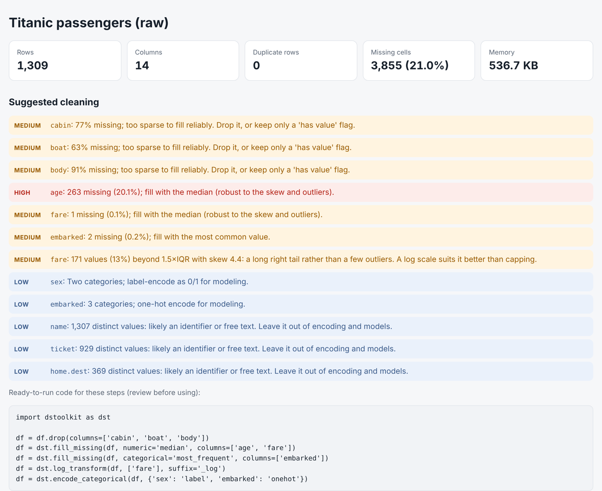

# dstoolkit

[](https://github.com/Dito-84/dstoolkit/actions/workflows/ci.yml)

**Data Science Toolkit**: a small, typed Python package for the first stages of a data project. It **profiles** a pandas DataFrame and suggests how to clean it, **cleans** it (duplicates, missing values, outliers, encoding, scaling), **validates** it against rules you write, and **explores** it (summary statistics, distribution plots, line fits). Every function returns a new DataFrame, so your raw data is never changed, and every function copes with missing values on its own.

## Install

```bash
pip install git+https://github.com/Dito-84/dstoolkit
```

Requires Python 3.10+, with pandas, NumPy, matplotlib and SciPy. k-nearest-neighbours filling (`fill_missing(numeric="knn")`) also needs scikit-learn, which is optional:

```bash
pip install "dstoolkit[knn] @ git+https://github.com/Dito-84/dstoolkit"
```

## What it's for, and what it isn't

dstoolkit is for **getting to know a dataset and cleaning it once**: profiling a new file, fixing types, checking it against rules, and preparing a clean copy for analysis or a dashboard. It's built to be safe by default: when a guess could damage data (reading 1/0 as True/False, swapping day and month, filling an ID column with its mean), it leaves the data alone or asks you to be explicit.

It is **not** a modelling pipeline. Functions such as `fill_missing`, `normalize`, `encode_categorical` and `handle_outliers` learn their numbers (means, ranges, categories, outlier bounds) from the DataFrame you pass in, and there is no separate fit and transform step. Run them on a full dataset before splitting it, and information from the test rows leaks into training. For machine learning, split first and fit any preprocessing inside cross-validation (scikit-learn's `Pipeline` does this), the way the [Titanic project](https://github.com/Dito-84/titanic-survival-prediction) fills missing ages inside each fold. dstoolkit's profile and validation still help before and after.

## Profile a dataset in one call

```python
import pandas as pd
import dstoolkit as dst

raw = pd.read_csv("data/titanic3.csv", na_values="?")
report = dst.profile(raw, title="Titanic passengers")
report                       # shows inline in Jupyter
report.save("report.html")   # one self-contained file to share
print(report.code())         # the suggested cleaning steps as runnable code
```

The report covers the whole dataset (rows, duplicates, missing cells), every column (type, missing values, statistics, outliers and a chart) and the correlations between numeric columns. It also reads the data and **suggests cleaning steps, with ready-to-run `dstoolkit` code**: which columns are too sparse to keep, which to fill and how, long tails that suit a log scale, numbers stored as text, categories to encode, and identifier columns to leave out of models.

[](docs/titanic_profile.html)

[Download the full example report](docs/titanic_profile.html) (open it in a browser), or see the [`Profile_Titanic`](notebooks/Profile_Titanic.ipynb) notebook, which profiles the raw data, applies the suggested code and profiles the result.

## Clean in one call

```python
df = dst.clean(
    raw,
    missing={"numeric": "median", "columns": ["age", "fare", "embarked"]},   # every step is opt-in
    outliers={"columns": ["fare"], "action": "cap"},
    encode={"columns": {"sex": "label", "embarked": "onehot"}},
)
# No duplicates found.
# Filled missing values: age (263), fare (1), embarked (2)
# Capped outliers: fare (171)
# sex labels: female=0, male=1
# Encoded sex (label), embarked (onehot).

dst.show_distribution_profile(df["age"], title="Passenger Age")
```

Each cleaning step prints a one-line summary of what it changed; pass `verbose=False` to silence it. Apart from removing exact duplicate rows, `clean()` changes nothing you don't ask for, and rows keep their original labels (the index), so any row can be traced back to the raw data.

## Validate against your own rules

```python
rules = {
    "age": {"type": "number", "min": 0, "max": 100, "required": True},
    "sex": {"allowed": ["male", "female"]},
    "fare": {"min": 0.01},
    "ticket": {"required": True},
}
check = dst.validate(raw, rules)
# Validated 1,309 rows against 7 rule(s): 2 failed (271 row(s)).
#   age: required (no blanks) failed for 263 row(s), e.g. row 15 = missing; row 37 = missing; row 40 = missing
#   fare: min (≥ 0.01) failed for 17 row(s), e.g. row 7 = 0; row 70 = 0; row 125 = 0

check.ok                       # False
check.summary()                # one row per rule: checked, failed, examples
check.failures()               # every failing value, with the reason
raw.loc[check.failing_index]   # the rows themselves
dst.validate(dst.clean(raw), rules).raise_if_failed()   # stop a pipeline on bad data
```

`checks` compare two columns in each row, with `==`, `!=`, `<`, `<=`, `>` or `>=`:

```python
dst.validate(stays, checks={
    "discharged on or after admission": ("discharge_date", ">=", "admission_date"),
})
# Validated 2 rows against 1 rule(s): 1 failed (1 row(s)).
#   discharged on or after admission: (discharge_date >= admission_date) failed for 1 row(s), e.g. row 1 = 2024-01-30 vs 2024-02-01
```

`validate()` reports problems; it never changes or converts the data. The text "12" is not a number, 1 is not True, and date text is not read as a date. Missing values are skipped by every rule except `required`, a column that doesn't exist is reported (with the closest name), and a mistake in the rules themselves raises before any data is read. Pass the same `rules=` and `checks=` to `profile()` to add a Validation section to the report.

Why not pandera or Great Expectations? They're the right tools for enforcing data contracts in production pipelines. `validate()` is for the exploration stage: it reports every failing row with examples instead of stopping at the first error, uses the same no-guessing rules as the rest of the toolkit, shows up in the same HTML report as the profile, and adds no dependencies. The rule format is experimental until 1.0.

## Cleaning: `dstoolkit.cleaning`

| Function | What it does |
|---|---|
| `to_boolean(df, columns)` | Yes/No text (any case, also Y/N, True/False) to True/False; blanks and "N/A" become missing. Columns with any other value are left alone |
| `to_datetime_columns(df, columns, min_share, dayfirst, format)` | Date text (2020-01-31, 01/31/2020, ...) to real dates. Day/month order is worked out per column from the data (13/02/2020 can only be day-first), never value by value; a column mixing both orders is left alone. Number columns are never turned into dates |
| `to_category(df, columns, max_unique)` | Repeated text labels (hospital, region) to pandas' category type |
| `convert_types(df)` | Runs the three type conversions above with safe defaults (categories optional) |
| `remove_duplicates(df, subset, keep)` | Drops duplicate rows, optionally judged on a subset of columns; kept rows keep their labels |
| `fill_missing(df, numeric, categorical, columns, knn_features)` | Fills gaps: mean, median, zero or k-nearest-neighbours for numbers (needs the `knn` extra; columns scaled first, and `knn_features` picks which columns judge similarity); most frequent value or "Missing" for text. Date gaps are left missing |
| `find_outliers(df, columns, method)` | True/False table of outliers by IQR or z-score |
| `handle_outliers(df, columns, method, action)` | Removes outlier rows (the rest keep their labels), or caps values at the bounds and keeps the rows |
| `winsorize(df, columns, lower, upper)` | Clips columns to percentiles (default 5th–95th) |
| `log_transform(df, columns, suffix)` | log(1 + x) for long right-tailed columns like income or price |
| `encode_categorical(df, columns)` | One-hot or label encoding per column; label codes keep missing values missing |
| `normalize(df, columns)` | Min-max (0–1) or z-score scaling per column |
| `add_age_column(df, dob_column, as_of)` | Age in completed years from a birth-date column, as of today or another date column. Unreadable or future birth dates give a missing age, and are counted in the summary |
| `clean(df, ...)` | Runs types → duplicates → missing values → outliers → encoding → scaling in one call. Only duplicate removal is on by default; every other step is opt-in |

## Profiling: `dstoolkit.profiling`

| Function / method | What it does |
|---|---|
| `profile(df, title, charts, max_categories, missing_ok, rules, checks)` | Builds the report; `missing_ok` names columns where blank is meaningful (no fill/drop advice); `rules`/`checks` add a Validation section |
| `report.save(path)` / `report.to_html()` | Self-contained HTML file or string |
| `report.summary()` | One row per column: type, missing, unique values, outliers |
| `report.suggestions` | The suggested steps as data (column, severity, message) |
| `report.code(df_name)` | The suggested steps as runnable code, one call per kind of step |
| `report.validation` | The `ValidationReport` when `rules` or `checks` were given, otherwise `None` |

## Validation: `dstoolkit.validation`

| Function / method | What it does |
|---|---|
| `validate(df, rules, checks, max_examples)` | Checks the data against rules and reports every problem, without changing it |
| rule `type` | `"number"`, `"integer"`, `"text"`, `"boolean"`, `"datetime"` or `"category"`; values are not converted first |
| rule `required` | No blanks: missing values or empty text ("N/A" counts as a value) |
| rules `min`, `max` | Lowest / highest value: numbers, or dates (written as `"2020-01-01"`) for date columns |
| rule `allowed` | The only values permitted; exact match, with a hint when only case or spaces differ |
| rule `unique` | No value appears more than once (blanks aren't counted) |
| rule `pattern` | Regular expression the whole value must match (Python's `re` on every pandas version) |
| `checks={name: (col, op, col)}` | Compares two columns in each row with `==`, `!=`, `<`, `<=`, `>`, `>=`; rows with a blank side are skipped |
| `report.ok` | True when every rule passed |
| `report.summary()` | One row per rule: expected, checked, failed, failed %, examples |
| `report.failures(column, rule)` | Every failing value: row label, column, rule, value and reason |
| `report.failing_index` | Labels of rows that failed any rule, for `df.loc[...]` |
| `report.raise_if_failed()` | Raises `ValidationError` (a `ValueError`) if any rule failed |

## Exploration: `dstoolkit.exploration`

| Function | What it does |
|---|---|
| `show_eda(series)` | Prints min, max, mean, median and mode |
| `show_eda_table(series)` | `.describe()` statistics drawn as a table |
| `show_histogram(series)` | Histogram with mean, median and mode lines |
| `show_distribution(series)` | Histogram stacked above a boxplot |
| `show_density(series)` | Density curve with mean and median lines |
| `show_distribution_profile(series)` | 2×2 overview: histogram, density, boxplot, summary table |
| `show_counts(series, top)` | Sorted bar chart of how often each value appears, with counts and shares; rare values grouped as "Other" |
| `show_grouped_box(df, value, by)` | A number compared across groups (e.g. length of stay by hospital), sorted by median, with group sizes |
| `show_scatter(x, y, size, trend)` | Scatterplot, optionally with bubble sizes and a fitted trend line |
| `fit_line(x, y)` | Least-squares line; returns slope, intercept and a `predict` function |
| `drop_nulls(data)` | Copy of a Series/DataFrame with null rows removed |
| `add_passed(df, grade_col, threshold)` | Adds a True/False column for values at or above a threshold |

Every chart function returns its matplotlib figure, so it can be saved with `fig.savefig("chart.png")`. In Jupyter, end the line with `;` (or assign the result) so the returned figure isn't shown twice.

Every function is also available directly from `dstoolkit`, as in the quick start.

## Notebooks

Worked examples on real data:

| Notebook | Covers |
|---|---|
| [`Profile_Titanic`](notebooks/Profile_Titanic.ipynb) | Profile the raw data, apply the suggested code, profile again, read what's left, and validate both against rules |
| [`Preprocessing_Titanic`](notebooks/Preprocessing_Titanic.ipynb) | Every cleaning step on the Titanic passenger list, then the same steps in one `clean()` call |
| [`Toolkit_on_Titanic_Data`](notebooks/Toolkit_on_Titanic_Data.ipynb) | The exploration functions on real data: missing ages, heavily skewed fares, fare by class |

[`notebooks/learning/`](notebooks/learning/) keeps the tutorial notebooks the package grew out of: NumPy and pandas basics, matplotlib practice, and building the distribution functions step by step.

## Project layout

```
src/dstoolkit/
    __init__.py       top-level API and version
    cleaning.py       duplicates, missing values, outliers, encoding, scaling, age
    profiling.py      profile() report and cleaning suggestions
    validation.py     validate() rules and checks
    exploration.py    summaries, distribution plots, line fits
    py.typed          marks the package as typed
tests/                pytest suite
notebooks/            worked examples on real data
notebooks/learning/   tutorial notebooks
docs/                 README screenshot and an example report
data/                 StudentData.csv, titanic3.csv
```

## Development

```bash
git clone https://github.com/Dito-84/dstoolkit
cd dstoolkit
pip install -e ".[dev]"
pytest --cov   # the test suite, with coverage (CI requires at least 95%)
mypy           # type check
ruff check .   # lint: style, import order, likely bugs
```

The tests check every function, including that inputs are never modified, that every plot draws when values are missing, that report HTML escapes column names, and that the code `profile()` suggests actually runs. GitHub Actions runs the linter, the type check, the tests with coverage and every notebook on Python 3.10 and 3.13 for each push and pull request, and runs the tests again with the oldest versions of pandas, NumPy, matplotlib, SciPy and scikit-learn that dstoolkit says it supports. See [CHANGELOG.md](CHANGELOG.md) for version history.

## Used in

- **[Hip & Knee Replacement Outcomes Dashboard](https://github.com/Dito-84/hip-knee-replacement-outcomes-dashboard)**: `scripts/check_data.py` profiles a real discharge export before the dashboard is built, using `missing_ok` because a blank complication or readmission means "didn't happen"
- **[Titanic Survival Prediction](https://github.com/Dito-84/titanic-survival-prediction)**: a data-quality check before modeling. Its suggestions inform the choices, but missing ages are still filled inside each cross-validation fold so no test data leaks into training

Both use dstoolkit as an optional extra, pinned to a tested commit, so changes here can't break them.

## Data

- `data/StudentData.csv`: 17 students' study hours and grades (two rows deliberately missing)
- `data/titanic3.csv`: Titanic passenger list from the Vanderbilt Biostatistics dataset, with `?` for missing values

## License

[MIT](LICENSE) © 2026 Rolando Rodriguez Jr.

## Credits

The cleaning steps were inspired by [AutoClean](https://github.com/elisemercury/AutoClean) by Elise Landman (MIT License), an automated preprocessing pipeline for pandas. The functions here are independent implementations.
