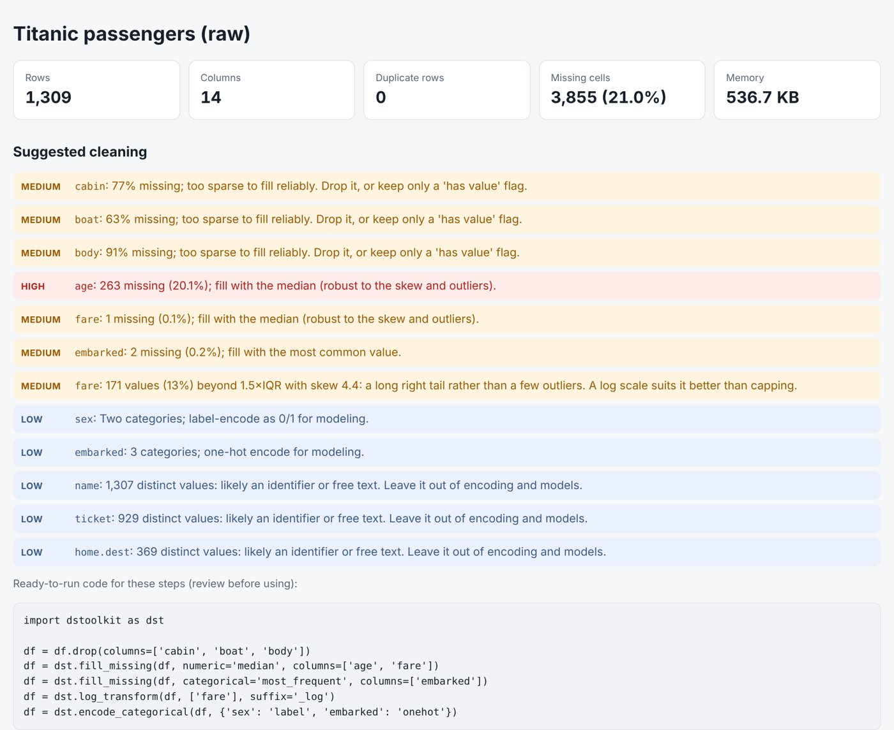

# dstoolkit

[](https://github.com/Dito-84/dstoolkit/actions/workflows/ci.yml)

**Data Science Toolkit**: a small, typed Python package for the first stages of a data project. It **profiles** a pandas DataFrame and suggests how to clean it, **cleans** it (duplicates, missing values, outliers, encoding, scaling), **validates** it against rules you write, **explores** it (summary statistics, distribution plots, line fits), and **prepares it for models** with scikit-learn transformers that learn on training data only. Every cleaning function returns a new DataFrame, so your raw data is never changed, and every function copes with missing values on its own. There's also a [drag-and-drop browser version](#browser-app) that needs no install.

## Install

```bash
pip install dstoolkit
```

Requires Python 3.10+, with pandas, NumPy, matplotlib and SciPy. The [scikit-learn transformers](#transformers-for-machine-learning-dstoolkittransformers) and k-nearest-neighbours filling also need scikit-learn, which is optional:

```bash
pip install "dstoolkit[sklearn]"
```

Releases are published to [PyPI](https://pypi.org/project/dstoolkit/) by GitHub Actions through trusted publishing, so no upload token exists to leak. To install the latest code from GitHub instead: `pip install git+https://github.com/Dito-84/dstoolkit`.

## What it's for, and what it isn't

dstoolkit is for **getting to know a dataset and cleaning it once**: profiling a new file, fixing types, checking it against rules, and preparing a clean copy for analysis or a dashboard. It's built to be safe by default: when a guess could damage data (reading 1/0 as True/False, swapping day and month, filling an ID column with its mean), it leaves the data alone or asks you to be explicit.

The cleaning functions (`fill_missing`, `normalize`, `encode_categorical`, `handle_outliers`) learn their numbers (means, ranges, categories, outlier bounds) from the DataFrame you pass in and apply them in the same call. That's right for exploring data, but **not before a model**: run them on a full dataset before splitting it, and information from the test rows leaks into training. For machine learning, use the [transformers](#transformers-for-machine-learning-dstoolkittransformers) instead. They learn on the training rows only and work inside a scikit-learn `Pipeline`, so cross-validation refits them on each fold.

## Design decisions

A few choices shape everything else:

- **Never change the input, never guess.** Functions return a new DataFrame. When a guess could damage data (1/0 as True/False, swapping day and month, filling an ID with its mean), dstoolkit leaves the data alone or asks you to be explicit.
- **Learn from training rows only.** The cleaning functions are for exploring. For models, the transformers fit on training data inside a scikit-learn `Pipeline`, so no test data leaks into training.
- **Report leaks, don't hide them.** `profile(target=...)` flags columns that give the answer away, and the generated script leaves them out with a comment. On the Titanic data, the lifeboat column alone lifts accuracy from 0.785 to 0.976.
- **Validate honestly.** Repeated patients get grouped folds, time-ordered data gets a past-to-future split, and every score is shown next to a no-skill baseline.
- **Judge drift by size, not significance.** `compare()` rates change by the population stability index, so thousands of rows don't make a trivial shift look alarming.

The reasons, alternatives and costs for these and more are in [docs/design-decisions.md](docs/design-decisions.md).

## Profile a dataset in one call

```python
import pandas as pd
import dstoolkit as dst

raw = pd.read_csv("data/titanic3.csv", na_values="?")
report = dst.profile(raw, title="Titanic passengers")
report                       # shows inline in Jupyter
report.save("report.html")   # one self-contained file to share
print(report.code())         # the suggested cleaning steps as runnable code
```

The report covers the whole dataset (rows, duplicates, missing cells), every column (type, missing values, statistics, outliers and a chart), the correlations between numeric columns, and **related columns of any type** (numbers, categories, or one of each, from [`associations()`](#exploration-dstoolkitexploration), with p-values corrected for testing many pairs). It also reads the data and **suggests cleaning steps, with ready-to-run `dstoolkit` code**: which columns are too sparse to keep, which to fill and how, long tails that suit a log scale, numbers stored as text, categories to encode, labels written more than one way ("Male", "male "), identifier columns to leave out of models, column names with hidden spaces or line breaks, and notes rows at the end of an export ("Source: ..." lines that aren't data). Those notes rows are left out of the column analysis, since they would make number columns look like text, and the code drops them first.

[](docs/titanic_profile.html)

[Download the full example report](docs/titanic_profile.html) (open it in a browser), or see the [`Profile_Titanic`](notebooks/Profile_Titanic.ipynb) notebook, which profiles the raw data, applies the suggested code and profiles the result.

## Prepare for a model

Name the column a model will predict, and the report checks the things to settle before training:

```python
report = dst.profile(raw, target="survived")
report.target.leaks        # ['boat']: whether a lifeboat is listed predicts survival almost perfectly
print(report.pipeline())   # a leak-free scikit-learn starter, ready to run
```

- **Class balance**, with a warning when the smallest class is under 10% of rows. The task is worked out from the target (text, True/False, or a few whole numbers mean classification); `task=` overrides it.
- **How strongly each feature is related to the target**, from `associations()`.
- **Possible leaks:** features almost perfectly related to the target, by value or by whether they're blank. On the Titanic, `boat` is blank for 99% of the people who died and filled in for 95% of those who survived: it was recorded after the sinking.
- **Blanks related to the target**, such as missing ages, where filling the gap would hide information unless a flag column keeps it.
- The target itself gets no fill, encoding or outlier advice; rows without a target are dropped.
- **Repeated identifiers:** an ID column whose values repeat (several admissions per patient, several bookings per customer) gets a warning. With `profile(..., group="patient_id")`, `pipeline()` splits by that column (`StratifiedGroupKFold` or `GroupKFold`), so the same patient is never in both training and test folds. A random split lets the model recognise patients it has already seen, and scores look better than they will be on new patients.

`report.pipeline()` turns the suggestions into a starter script. Steps that learn nothing from the data (type fixes, log transforms) run before the split. Steps that learn from it (fill values, outlier bounds, categories) go inside a scikit-learn `Pipeline` of dstoolkit transformers, so cross-validation refits them on each training fold. Date columns become month and day-of-week features (not year: new data comes from years the model never saw), and a date of birth becomes an age on another date in the data. Leaks and identifiers are left out of the features, with a comment saying why:

```python
# 2. Features and target
# Left out (possible leaks: check they were known before the outcome): boat
# Left out (suggested for dropping): cabin, body
# Left out (identifiers or free text): name, ticket, home.dest
X = df[['pclass', 'sex', 'age', 'sibsp', 'parch', 'fare', 'embarked']]
y = df['survived']

# 3. Steps that learn from the data: inside the pipeline, refitted on each training fold
model = make_pipeline(
    dst.MissingFiller(numeric='median', categorical=None, columns=['age', 'fare']),
    dst.MissingFiller(categorical='most_frequent', numeric=None, columns=['embarked']),
    dst.CategoryEncoder({'sex': 'label', 'embarked': 'onehot'}, drop_original=True),
    HistGradientBoostingClassifier(learning_rate=0.03, max_iter=200, max_depth=3, min_samples_leaf=40, random_state=0),
)
```

It ends by scoring a no-skill baseline on the same folds, so the result has something to beat: on the Titanic, ROC AUC 0.859 against 0.500 for always guessing the most common class. The model accepts blanks and needs no scaling. Its trees are small and learn slowly: with scikit-learn's default settings it fits small tables too closely, and on the hospital demo its risks were overconfident (the riskiest tenth predicted 63% against 48% actually readmitted). The gentler settings fix that and rank better too; the script says what to add before swapping in one that doesn't, such as logistic regression.

It's a starting point to review, not a finished model: whether a flagged column really leaks, and which model to use, are your decisions. Two parameters record those decisions:

- `profile(..., after_outcome=["body"])` marks columns you know were recorded after the outcome. The statistics can miss them: on the Titanic, `body` (a body identification number) only exists for people who died, but so few bodies were recovered that its blanks look only moderately related to survival.
- `report.pipeline(missing_flags=["age"])` keeps a 0/1 flag for blanks that carry signal. Flags are never added unless you ask, because a blank recorded after the outcome leaks the answer.
- `report.pipeline(time_column="admitted")` splits by time: rows are sorted by that date, and each fold trains on earlier rows and tests on later ones. Random and grouped folds mix past and future; a time split is the honest estimate for a model that will predict next month's cases.

Dates are checked for leaks too: each date, and the days between each pair of dates, are tested against the target. Predicting length of stay, `discharged` minus `admitted` *is* the answer, so the report flags `discharged` (the later date) as a possible leak. Dates written both day-first and month-first are never guessed at: the report counts how many can only be read one way and how many could be either, so they can be fixed at the source.

### Dataset size

Timed with 16 columns (numbers, categories and an ID), charts and a target: about 3 seconds for 10,000 rows, 6 seconds for 100,000, and 50 seconds for a million. For large data, `profile(df, sample=20_000)` profiles a fixed random 20,000 rows (about 5 seconds at a million rows); the row, duplicate and missing counts and any validation still use every row, and the report says what was sampled. The related-columns section is skipped above 30 columns.

## Clean in one call

```python
df = dst.clean(
    raw,
    missing={"numeric": "median", "columns": ["age", "fare", "embarked"]},   # every step is opt-in
    outliers={"columns": ["fare"], "action": "cap"},
    encode={"columns": {"sex": "label", "embarked": "onehot"}},
)
# No duplicates found.
# Filled missing values: age (263), fare (1), embarked (2)
# Capped outliers: fare (171)
# sex labels: female=0, male=1
# Encoded sex (label), embarked (onehot).

dst.show_distribution_profile(df["age"], title="Passenger Age")
```

Each cleaning step prints a one-line summary of what it changed; pass `verbose=False` to silence it. Apart from removing exact duplicate rows, `clean()` changes nothing you don't ask for, and rows keep their original labels (the index), so any row can be traced back to the raw data.

### Messages and logging

The summaries go through Python's standard `logging` (logger name `"dstoolkit"`, INFO level). By default they're simply printed, so nothing changes in notebooks. In a pipeline or a scheduled job, send them to your own logging setup instead, so they get timestamps and land wherever your logs go (a file, AWS CloudWatch from a Lambda function):

```python
import logging
logging.basicConfig(level=logging.INFO, format="%(asctime)s %(name)s %(message)s")
dst.set_message_output("logging")   # or "print" (default), or "off" to silence everything
```

## Validate against your own rules

```python
rules = {
    "age": {"type": "number", "min": 0, "max": 100, "required": True},
    "sex": {"allowed": ["male", "female"]},
    "fare": {"min": 0.01},
    "ticket": {"required": True},
}
check = dst.validate(raw, rules)
# Validated 1,309 rows against 7 rule(s): 2 failed (271 row(s)).
#   age: required (no blanks) failed for 263 row(s), e.g. row 15 = missing; row 37 = missing; row 40 = missing
#   fare: min (≥ 0.01) failed for 17 row(s), e.g. row 7 = 0; row 70 = 0; row 125 = 0

check.ok                       # False
check.summary()                # one row per rule: checked, failed, examples
check.failures()               # every failing value, with the reason
raw.loc[check.failing_index]   # the rows themselves
dst.validate(dst.clean(raw), rules).raise_if_failed()   # stop a pipeline on bad data
```

`checks` compare two columns in each row, with `==`, `!=`, `<`, `<=`, `>` or `>=`:

```python
dst.validate(stays, checks={
    "discharged on or after admission": ("discharge_date", ">=", "admission_date"),
})
# Validated 2 rows against 1 rule(s): 1 failed (1 row(s)).
#   discharged on or after admission: (discharge_date >= admission_date) failed for 1 row(s), e.g. row 1 = 2024-01-30 vs 2024-02-01
```

`validate()` reports problems; it never changes or converts the data. The text "12" is not a number, 1 is not True, and date text is not read as a date. Missing values are skipped by every rule except `required`, a column that doesn't exist is reported (with the closest name), and a mistake in the rules themselves raises before any data is read. Pass the same `rules=` and `checks=` to `profile()` to add a Validation section to the report.

Why not pandera or Great Expectations? They're the right tools for enforcing data contracts in production pipelines. `validate()` is for the exploration stage: it reports every failing row with examples instead of stopping at the first error, uses the same no-guessing rules as the rest of the toolkit, shows up in the same HTML report as the profile, and adds no dependencies. The rule format is experimental until 1.0.

## Check new data before scoring it: `dst.compare()`

A model only works on data like the data it learned from. `compare()` checks every column of a new batch against the reference data and returns one row per column, biggest changes first:

```python
changes = dst.compare(train, new_batch)
changes[changes["status"] != "stable"]
# Compared 13 column(s): 4 major; 9 stable.
#   admission_type  major  distribution shifted (PSI 9.48); 1 new value(s), 53.2% of new rows: ER
#   hba1c           major  distribution shifted (PSI 7.96)
#   diagnosis_code  major  7 new value(s), 8.9% of new rows: U07, ...
#   prior_admissions_12m  major  blanks 0.0% → 15.0%
```

| Check | What it catches | Status |
|---|---|---|
| Type | Numbers arriving as text, text arriving as numbers | major |
| Shift | Population stability index (PSI): over the reference's deciles for numbers, over the categories for the rest (rare categories under 1% share one bin, so a long tail isn't noise) | moderate from 0.1, major from 0.25 (the usual rule of thumb) |
| Blanks | A change in the share of missing values | moderate from 2 points, major from 10 |
| New values | Categories the reference never had (a new code, a relabelled category) | moderate from 2% of new rows, major from 5% |
| Columns | Added or removed | added / removed |

A p-value (Kolmogorov-Smirnov or chi-square, adjusted for testing many columns) is reported but doesn't set the status: with thousands of rows, tiny harmless shifts are "significant". Dates are expected to move forward, so their distribution isn't compared, and identifiers (many values, mostly distinct) only get the type and blank checks. Nothing is changed. The [`Hospital_Readmissions`](notebooks/Hospital_Readmissions.ipynb) notebook shows it catching a lab unit change, a relabelled admission type, a new diagnosis code and missing counts.

## Transformers for machine learning: `dstoolkit.transformers`

The same cleaning steps, split into **fit** (learn from training data) and **transform** (apply to any data), following scikit-learn's rules. Needs the `sklearn` extra.

```python
from sklearn.pipeline import make_pipeline
from sklearn.linear_model import LogisticRegression
from sklearn.model_selection import StratifiedKFold, cross_val_score

model = make_pipeline(
    dst.MissingFiller(numeric="median", categorical="most_frequent"),
    dst.OutlierCapper(columns=["fare"]),
    dst.CategoryEncoder({"sex": "label", "embarked": "onehot"}, drop_original=True),
    dst.Scaler({"age": "zscore", "fare": "zscore"}),
    LogisticRegression(max_iter=1000),
)
folds = StratifiedKFold(5, shuffle=True, random_state=0)   # shuffle: titanic3.csv is sorted by class
cross_val_score(model, X, y, cv=folds)   # cleaning is refitted on each training fold: no leakage
```

| Transformer | Learns in `fit()` | Applies in `transform()` |
|---|---|---|
| `MissingFiller(numeric, categorical, columns, add_indicator)` | Mean, median or zero for numbers; most frequent value or "Missing" for text (`fill_values_`); with `add_indicator`, which columns get a flag (`indicator_columns_`) | Fills gaps with those values. Date gaps stay missing; no rows are dropped. `add_indicator=True` (columns with gaps in training) or a list adds a 0/1 `<column>_missing` flag first, so a blank that carries signal isn't lost |
| `OutlierCapper(columns, method, threshold)` | IQR or z-score bounds (`bounds_`) | Caps values at the bounds; rows are kept |
| `CategoryEncoder(columns, handle_unknown, drop_original, min_frequency, other_label)` | The categories in each column (`categories_`), and with `min_frequency` the rare ones (`rare_`) | One-hot or label codes for those categories. Unseen categories are ignored (zeros, or a missing label) or raise an error. With `min_frequency` (rows, or a share such as 0.01), rare categories, and unseen ones, are grouped into "Other": useful for diagnosis codes, providers or ZIP codes with hundreds of mostly rare values |
| `Scaler(columns)` | Min and range, or mean and standard deviation (`stats_`) | Min-max or z-score scaling with the training numbers |
| `DateFeatures(columns, parts, intervals, drop_original, ages)` | Nothing (which columns are dates: `date_columns_`) | Splits date columns into numbers a model can use (`<column>_year`, `_month`, `_dayofweek`, and `day`, `dayofyear`, `quarter` or `hour` if asked). `intervals={"stay_days": ("admitted", "discharged")}` adds the days between two dates, and `ages={"age_at_admission": ("date_of_birth", "admitted")}` the age in completed years (missing, not negative, if the birth date is later). Drops the date columns by default, since most models can't take dates |

On the data they were fitted on, they give the same results as `fill_missing`, `handle_outliers(action="cap")`, `encode_categorical` and `normalize`. They take and return DataFrames (they need column names; inside a `ColumnTransformer`, call `.set_output(transform="pandas")`), support `get_feature_names_out()`, and can be cloned and pickled like any scikit-learn transformer.

## Browser app

[`app/`](app/) is a drag-and-drop page: drop a CSV or Excel file to get the profile and a list of suggested cleaning steps, untick any you don't want, and download the cleaned CSV, the report and a Python script that repeats the same steps. Python runs inside the browser ([Pyodide](https://pyodide.org)), so the file is never uploaded. A Content-Security-Policy makes the browser enforce that: the page may only talk to its own site and one pinned Pyodide release. It's tested end to end in a real browser in CI. It's live at [dito-84.github.io/dstoolkit](https://dito-84.github.io/dstoolkit/); see [`app/README.md`](app/README.md) to run it locally.

## Cleaning: `dstoolkit.cleaning`

| Function | What it does |
|---|---|
| `clean_column_names(df, case)` | Tidies column names from exports: removes hidden spaces and line breaks, then `"snake"` (default: `"Patient Age \n(years) "` → `patient_age_years`), `"pascal"` or `"strip"` (spaces only). Names that would clash get `_2`, `_3`, a name that's already clean keeps it, and every rename is reported |
| `to_boolean(df, columns)` | Yes/No text (any case, also Y/N, True/False) to True/False; blanks and "N/A" become missing. Columns with any other value are left alone |
| `to_datetime_columns(df, columns, min_share, dayfirst, format)` | Date text (2020-01-31, 01/31/2020, ...) to real dates. Day/month order is worked out per column from the data (13/02/2020 can only be day-first), never value by value; a column mixing both orders is left alone. Number columns are never turned into dates |
| `to_category(df, columns, max_unique)` | Repeated text labels (hospital, region) to pandas' category type |
| `convert_types(df)` | Runs the three type conversions above with safe defaults (categories optional) |
| `standardize_labels(df, columns, mapping, unmatched)` | One spelling per label: `{"Female": ["f", "woman"], "Male": ["m", "man"]}`, or a list of labels when spellings only differ by case and spaces. Values that match nothing are kept (or made missing, or raise), and always listed in the summary |
| `remove_duplicates(df, subset, keep)` | Drops duplicate rows, optionally judged on a subset of columns; kept rows keep their labels |
| `fill_missing(df, numeric, categorical, columns, knn_features)` | Fills gaps: mean, median, zero or k-nearest-neighbours for numbers (needs the `sklearn` extra; columns scaled first, and `knn_features` picks which columns judge similarity); most frequent value or "Missing" for text. Date gaps are left missing |
| `find_outliers(df, columns, method)` | True/False table of outliers by IQR or z-score |
| `handle_outliers(df, columns, method, action)` | Removes outlier rows (the rest keep their labels), or caps values at the bounds and keeps the rows |
| `winsorize(df, columns, lower, upper)` | Clips columns to percentiles (default 5th–95th) |
| `log_transform(df, columns, suffix)` | log(1 + x) for long right-tailed columns like income or price |
| `encode_categorical(df, columns)` | One-hot or label encoding per column; label codes keep missing values missing |
| `normalize(df, columns)` | Min-max (0–1) or z-score scaling per column |
| `add_age_column(df, dob_column, as_of)` | Age in completed years from a birth-date column, as of today or another date column. Unreadable or future birth dates give a missing age, and are counted in the summary |
| `clean(df, ...)` | Runs types → duplicates → missing values → outliers → encoding → scaling in one call. Only duplicate removal is on by default; every other step is opt-in |

## Profiling: `dstoolkit.profiling`

| Function / method | What it does |
|---|---|
| `profile(df, title, charts, max_categories, missing_ok, rules, checks, related, target, task, after_outcome, group, sample)` | Builds the report; `missing_ok` names columns where blank is meaningful (no fill/drop advice); `rules`/`checks` add a Validation section; `related=False` leaves out the Related columns section; `target` adds a Target section (see [Prepare for a model](#prepare-for-a-model)); `after_outcome` names columns you know were recorded after the outcome, treated as leaks; `group` names the column identifying a patient or customer with several rows, so `pipeline()` uses grouped folds; `sample` profiles a fixed random subset of a large dataset (see [Dataset size](#dataset-size)) |
| `report.save(path)` / `report.to_html()` | Self-contained HTML file or string |
| `report.summary()` | One row per column: type, missing, unique values, outliers |
| `report.suggestions` | The suggested steps as data (column, severity, message) |
| `report.code(df_name)` | The suggested steps as runnable code, one call per kind of step. These functions learn from every row: use them for exploring, and `pipeline()` for models |
| `report.pipeline(df_name, missing_flags, time_column)` | A leak-free modelling starter (needs `target`); `missing_flags` keeps 0/1 flags for the blanks you've judged were known before the outcome; `time_column` splits by time (`TimeSeriesSplit`): stateless steps before the split, learned steps in a scikit-learn `Pipeline`, cross-validated against a no-skill baseline |
| `report.validation` | The `ValidationReport` when `rules` or `checks` were given, otherwise `None` |
| `report.target` | A `TargetProfile` when `target` was given: `task`, `classes`, `features` (each feature vs the target), `missingness`, `leaks`, `untested` |
| `report.associations` | The related pairs, as returned by `associations()`. `None` when `related=False`, or above 30 columns, where the number of pairs makes it slow (`report.associations_skipped` says why); call `associations()` on the columns you need instead |

## Validation: `dstoolkit.validation`

| Function / method | What it does |
|---|---|
| `validate(df, rules, checks, max_examples)` | Checks the data against rules and reports every problem, without changing it |
| rule `type` | `"number"`, `"integer"`, `"text"`, `"boolean"`, `"datetime"` or `"category"`; values are not converted first |
| rule `required` | No blanks: missing values or empty text ("N/A" counts as a value) |
| rules `min`, `max` | Lowest / highest value: numbers, or dates (written as `"2020-01-01"`) for date columns |
| rule `allowed` | The only values permitted; exact match, with a hint when only case or spaces differ |
| rule `unique` | No value appears more than once (blanks aren't counted) |
| rule `pattern` | Regular expression the whole value must match (Python's `re` on every pandas version) |
| rule `format` | A named format: `"us_zip"` (12345 or 12345-6789), `"us_phone"` (10-digit US number, written any common way) or `"email"`. Failures say what's wrong, e.g. a ZIP code stored as a number that lost its leading zero (2134 → 02134) |
| `checks={name: (col, op, col)}` | Compares two columns in each row with `==`, `!=`, `<`, `<=`, `>`, `>=`; rows with a blank side are skipped |
| `report.ok` | True when every rule passed |
| `report.summary()` | One row per rule: expected, checked, failed, failed %, examples |
| `report.failures(column, rule)` | Every failing value: row label, column, rule, value and reason |
| `report.failing_index` | Labels of rows that failed any rule, for `df.loc[...]` |
| `report.raise_if_failed()` | Raises `ValidationError` (a `ValueError`) if any rule failed |

## Exploration: `dstoolkit.exploration`

| Function | What it does |
|---|---|
| `show_eda(series)` | Prints min, max, mean, median and mode |
| `show_eda_table(series)` | `.describe()` statistics drawn as a table |
| `show_histogram(series)` | Histogram with mean, median and mode lines |
| `show_distribution(series)` | Histogram stacked above a boxplot |
| `show_density(series)` | Density curve with mean and median lines |
| `show_distribution_profile(series)` | 2×2 overview: histogram, density, boxplot, summary table |
| `show_counts(series, top)` | Sorted bar chart of how often each value appears, with counts and shares; rare values grouped as "Other" |
| `show_grouped_box(df, value, by)` | A number compared across groups (e.g. length of stay by hospital), sorted by median, with group sizes |
| `show_scatter(x, y, size, trend)` | Scatterplot, optionally with bubble sizes and a fitted trend line |
| `fit_line(x, y)` | Least-squares line; returns slope, intercept and a `predict` function |
| `associations(df, columns, method, alpha, min_strength, target)` | Which columns are related: one row per pair (or, with `target`, only the pairs that include it), tested once on the rows where both values are present. Pearson or Spearman for numbers, chi-square with Cramér's V for categories, ANOVA with eta for a number and a category. P-values are corrected for testing many pairs (Benjamini-Hochberg), and notes flag results that need care |
| `drop_nulls(data)` | Copy of a Series/DataFrame with null rows removed |
| `add_passed(df, grade_col, threshold)` | Adds a True/False column for values at or above a threshold |

Every chart function returns its matplotlib figure, so it can be saved with `fig.savefig("chart.png")`. In Jupyter, end the line with `;` (or assign the result) so the returned figure isn't shown twice.

Every function is also available directly from `dstoolkit`, as in the quick start.

### Which columns are related?

```python
dst.associations(raw)
# Tested 43 pair(s) of columns; 16 significant (adjusted p < 0.05, strength at least 0.3). Left out: name (1,307 distinct values), ...
#   column_1  column_2  kind     test      measure  strength  p_value  p_adjusted  n     note
#   pclass    fare      numeric  Spearman  rho      -0.71     ...      ...         1308
#   survived  sex       mixed    ANOVA     eta       0.53     ...      ...         1309
```

Each pair is tested on the rows where both values are present, so missing values never pair one row's value with another's. With many pairs, some look significant by chance, so `p_adjusted` corrects for the number of tests. `significant_only=False` returns every pair.

## Notebooks

Worked examples on real data:

| Notebook | Covers |
|---|---|
| [`Profile_Titanic`](notebooks/Profile_Titanic.ipynb) | Profile the raw data, apply the suggested code, profile again, read what's left, and validate both against rules |
| [`Preprocessing_Titanic`](notebooks/Preprocessing_Titanic.ipynb) | Every cleaning step on the Titanic passenger list, then the same steps in one `clean()` call |
| [`Toolkit_on_Titanic_Data`](notebooks/Toolkit_on_Titanic_Data.ipynb) | The exploration functions on real data: missing ages, heavily skewed fares, fare by class |
| [`Modelling_Titanic`](notebooks/Modelling_Titanic.ipynb) | From raw data to a model: `associations()` finds what's related to survival (and a column that leaks the answer), `validate()` checks the inputs, and a pipeline of dstoolkit transformers is cross-validated against a no-skill baseline |
| [`Hospital_Readmissions`](notebooks/Hospital_Readmissions.ipynb) | Realistic problems on made-up hospital data (`data/synthetic_admissions.csv`, generated by `data/make_admissions.py`; no real patients): several admissions per patient and grouped folds, a leak found automatically and one declared with `after_outcome=`, informative lab blanks as flags, rare diagnosis codes grouped, dates turned into a length of stay, checking that the risks are calibrated and what calling the riskiest 10% would catch, saving the fitted model, and `compare()` catching problems in a new batch |

[`notebooks/learning/`](notebooks/learning/) keeps the tutorial notebooks the package grew out of: NumPy and pandas basics, matplotlib practice, and building the distribution functions step by step.

## Project layout

```
src/dstoolkit/
    __init__.py       top-level API and version
    cleaning.py       duplicates, missing values, outliers, encoding, scaling, age
    profiling.py      profile() report and cleaning suggestions
    validation.py     validate() rules and checks
    monitoring.py     compare(): has new data drifted from the reference data?
    transformers.py   scikit-learn transformers (fit on training data, transform anything)
    _messages.py      where the one-line summaries go (print, logging or off)
    exploration.py    summaries, distribution plots, line fits
    py.typed          marks the package as typed
tests/                pytest suite
app/                  drag-and-drop browser app (page, Python glue, build script, tests)
notebooks/            worked examples on real data
notebooks/learning/   tutorial notebooks
docs/                 design decisions, README screenshot and an example report
data/                 StudentData.csv, titanic3.csv
.github/workflows/    CI (tests, minimum versions, browser app), the GitHub Pages deploy and the PyPI release
```

## Development

```bash
git clone https://github.com/Dito-84/dstoolkit
cd dstoolkit
pip install -e ".[dev]"
pytest --cov   # the test suite, with coverage (CI requires at least 95%)
mypy           # type check
ruff check .   # lint: style, import order, likely bugs
```

The tests check every function, including that inputs are never modified, that every plot draws when values are missing, that report HTML escapes column names, that the code `profile()` suggests actually runs, and that the transformers learn nothing from test data. Every bug fix has a test that reproduces the bug. The browser app is tested end to end in a real Chromium, and fails on any security-policy violation. GitHub Actions runs the linter, the type check, the tests with coverage and every notebook on Python 3.10, 3.13 and 3.14 for each push and pull request, and runs the tests again with the oldest versions of pandas, NumPy, matplotlib, SciPy and scikit-learn that dstoolkit says it supports. See [CHANGELOG.md](CHANGELOG.md) for version history.

Changes go through a pull request and squash-merge. The branch rules for `main` are kept in [`.github/rulesets/protect-main.json`](.github/rulesets/protect-main.json): a pull request is required, all four CI checks must pass on an up-to-date branch, merges are squash-only, and `main` can't be force-pushed or deleted. A test keeps the required checks in step with the CI jobs.

## Used in

- **[Hip & Knee Replacement Outcomes Dashboard](https://github.com/Dito-84/hip-knee-replacement-outcomes-dashboard)** (built on synthetic data): `scripts/check_data.py` profiles a discharge export on the analyst's own computer before a dashboard is built from it, using `missing_ok` because a blank complication or readmission means "didn't happen"
- **[Titanic Survival Prediction](https://github.com/Dito-84/titanic-survival-prediction)**: a data-quality check before modeling. Its suggestions inform the choices, but missing ages are still filled inside each cross-validation fold so no test data leaks into training

Both use dstoolkit as an optional extra, pinned to a tested commit, so changes here can't break them.

## Data

- `data/StudentData.csv`: 17 students' study hours and grades (two rows deliberately missing)
- `data/titanic3.csv`: Titanic passenger list from the Vanderbilt Biostatistics dataset, with `?` for missing values
- `data/synthetic_admissions.csv`: made-up hospital admissions generated by `data/make_admissions.py` from a fixed seed; no real patients

## License

[MIT](LICENSE) © 2026 Rolando Rodriguez Jr.

## Credits

The cleaning steps were inspired by [AutoClean](https://github.com/elisemercury/AutoClean) by Elise Landman (MIT License), an automated preprocessing pipeline for pandas. The functions here are independent implementations.
